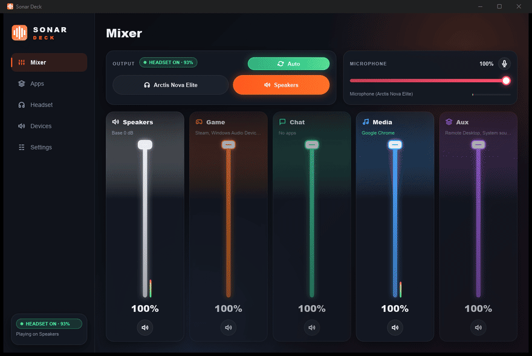
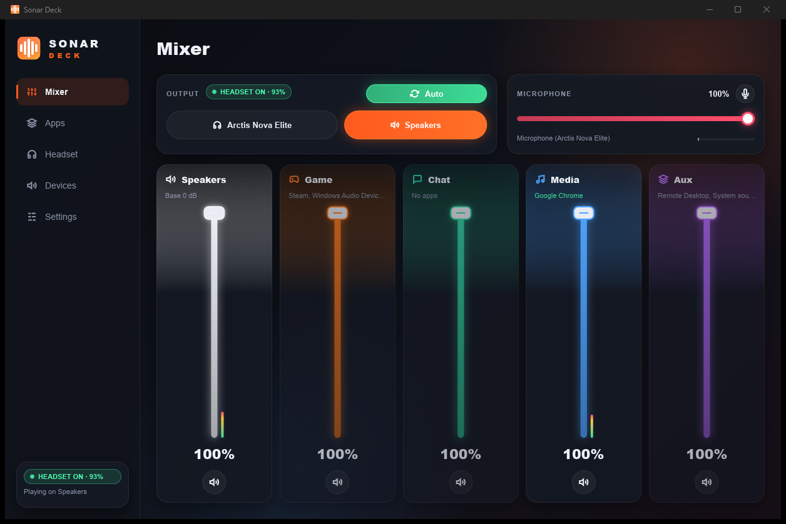
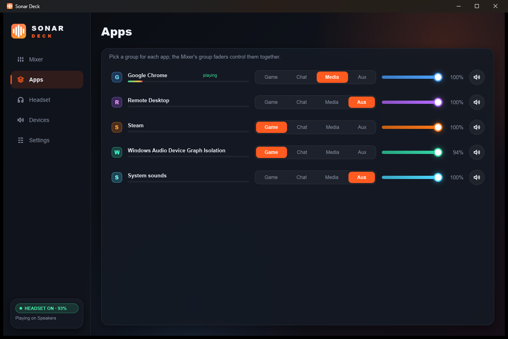
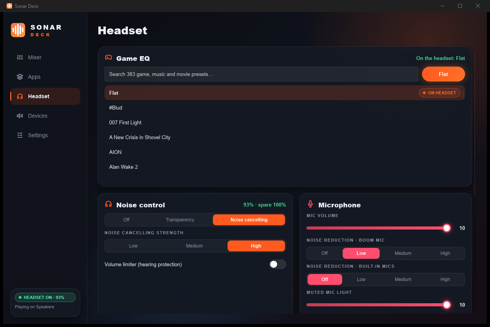
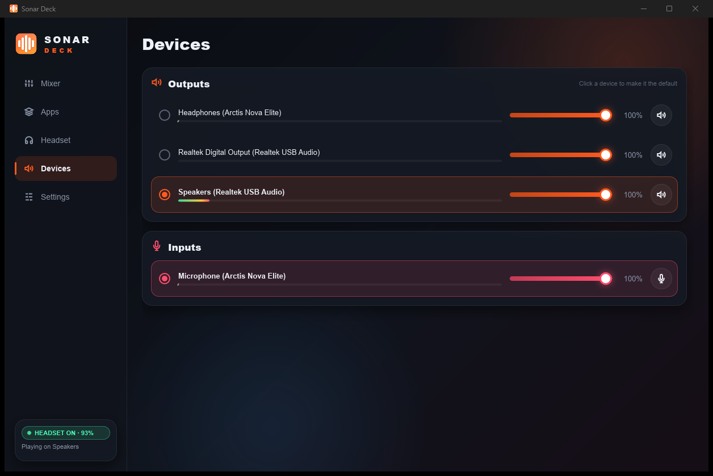

<p align="center">
  
</p>

<h1 align="center">Sonar Deck</h1>

<p align="center">
  A fast, native audio control deck for Windows: one-click headset/speaker switching, a per-app mixer with
  groups, and full control of SteelSeries Arctis Nova Elite headsets — without SteelSeries GG running.
</p>

<p align="center">
  <a href="https://github.com/aliforever/sonar-deck/releases/latest"></a>
  <a href="https://github.com/aliforever/sonar-deck/actions/workflows/ci.yml"></a>
  
  
</p>

<p align="center"></p>

## Features

**Works with any audio device**

- **Quick switch** — make the headset or the speakers the Windows default (output *and* microphone) with one
  click, from the tray, or with **Ctrl+Alt+F12** from anywhere, even when the window is closed.
- **Mixer groups** — Game, Chat, Media and Aux faders with mute and live level meters, like Sonar's channels.
  Apps are sorted automatically (Discord/Telegram → Chat, browsers/Spotify → Media, …) and can be moved.
- **App mixer** — per-app volume, mute and level meters for everything that plays sound.
- **Devices** — every output and input with volume, mute and meters; click to make one the default.
- **Tray app** — closing the window keeps it in the tray; launch at login starts it hidden; a second launch
  brings the running window forward. The tray tooltip shows the current output.

**SteelSeries Arctis Nova Elite** (talks to the USB dongle directly; SteelSeries GG is not needed)

- **Auto switch** — follows the headset's power switch: headset on → headset, headset off → speakers.
- **Battery** — headset and spare (hot-swap) battery levels.
- **Base station volume knob** — works as the master volume for every output, as it did with Sonar.
- **Software volume** — the Nova Elite ignores Windows' hardware volume; Sonar Deck applies the Windows
  volume to every app instead, so volume keys and the Windows flyout work.
- **Game EQ** — 383 game, music and movie presets for the headset's onboard EQ (Dota 2, CS, Valorant,
  Cyberpunk 2077, …). Presets go to the headset's game slot; your Custom EQ slot is never touched.
- **Headset settings** — noise cancelling / transparency and their levels, volume limiter, mic volume,
  noise reduction (boom and built-in mics), muted-mic light, sidetone, auto-off timer, Bluetooth defaults,
  and the base station display. Changes are saved on the headset.

## Screenshots

| Mixer | Apps |
|---|---|
|  |  |
| **Headset** | **Devices** |
|  |  |

## Install

Download the latest release from the **[Releases page](https://github.com/aliforever/sonar-deck/releases/latest)**:

- **`SonarDeck-Setup-x.y.z.exe`** — installer (no admin rights needed). Adds Start-menu shortcuts, the
  Ctrl+Alt+F12 hotkey, and optionally starts Sonar Deck at login.
- **`sonar-deck-x.y.z-windows-x64.zip`** — portable; just run `sonar-deck.exe`.
- **Scoop**:
  `scoop install https://github.com/aliforever/sonar-deck/releases/latest/download/sonar-deck.json`

Windows SmartScreen may warn about an unrecognised app because the executable isn't code-signed.
Choose **More info → Run anyway**, or build it yourself (below).

If SteelSeries GG is installed, quit it (and turn off its "start with Windows") so the two apps don't fight
over the headset and default devices.

## Command line

```
sonar-deck status                 # devices, apps and headset state
sonar-deck toggle                 # headset <-> speakers (used by the Ctrl+Alt+F12 shortcut)
sonar-deck headset | speakers     # switch to one of them
sonar-deck auto                   # pick based on whether the headset is on
sonar-deck volume [0-100]         # show or set the default output volume
sonar-deck headset [key value]    # show headset settings, or change one (e.g. anc-mode 2)
sonar-deck eq [preset name]       # show or load an onboard EQ preset (e.g. sonar-deck eq Dota 2)
sonar-deck login [on|off]         # launch at login (starts hidden in the tray)
sonar-deck --tray                 # start hidden in the tray
sonar-deck uninstall              # remove the login entry and settings
```

## Supported hardware

| Device | Support |
|---|---|
| Any Windows output/input | Switching, app mixer, groups, device volume |
| SteelSeries Arctis Nova Elite (USB dongle, PID `0x2244`) | Everything above plus headset features — tested |
| Other SteelSeries headsets | Windows audio features only; headset protocol contributions welcome |

## How it works

- **Windows Core Audio** (`IMMDeviceEnumerator`, `IAudioEndpointVolume`, `IAudioSessionManager2`,
  `IAudioMeterInformation`) for devices, apps and meters, and the `IPolicyConfig` interface (used by
  Windows' own sound settings and tools such as EarTrumpet) to change default devices.
- **Software volume**: app session volumes are set to *app level × group level × master*, where master is the
  base station knob (and, for the headset, the Windows volume). Sonar Deck remembers which volumes it set
  itself, so restarts never mistake its scaling for a level you chose.
- **Headset protocol** (vendor HID on the dongle, collection `0xFFC0`, report ID 1):
  `0xB0` status (byte 14: 2.4 GHz link, 8 = headset connected; byte 6 headset battery; byte 7 spare battery),
  `0x20` audio settings, `0x80` display settings, setting writes such as `0xBD` ANC mode, `0x37` mic volume,
  `0x09` save to flash, and feature report `0x1B` for onboard EQ presets. The base station pushes knob turns as
  `07 25 NN` on collection `0xFF00` (NN = dB below the top of the dial).

The protocol was worked out from the behaviour of the dongle and the official software's device
descriptions; see [`src/headset.rs`](src/headset.rs) for the full field layout.

## Build

Requires Windows 10/11 and the [Rust toolchain](https://rustup.rs) with the MSVC target (Visual Studio Build
Tools with the "Desktop development with C++" workload).

```
cargo build --release      # target\release\sonar-deck.exe
cargo test
```

The UI is written in [Slint](https://slint.dev) (`ui/`). The app builds on macOS and Linux too, but the native
audio backend is currently Windows-only.

### Development switches

| Variable | Effect |
|---|---|
| `SONAR_DECK_PAGE=0..4` | Open on a page (Mixer, Apps, Headset, Devices, Settings) — handy for screenshots |
| `SONAR_DECK_LOG=1` | Write a diagnostic log to `%TEMP%\sonar-deck.log` (knob events, software volume) |

Settings live in `%APPDATA%\SonarDeck\settings.json`. The icon is generated by `assets/make_icon.py`.

## Disclaimer

Sonar Deck is an independent project and is not affiliated with or endorsed by SteelSeries. "SteelSeries",
"Arctis" and "Sonar" are trademarks of their respective owners. The bundled EQ presets
(`assets/eq_presets.json`) were exported from SteelSeries GG's headset preset library.

## License

[MIT](LICENSE)
